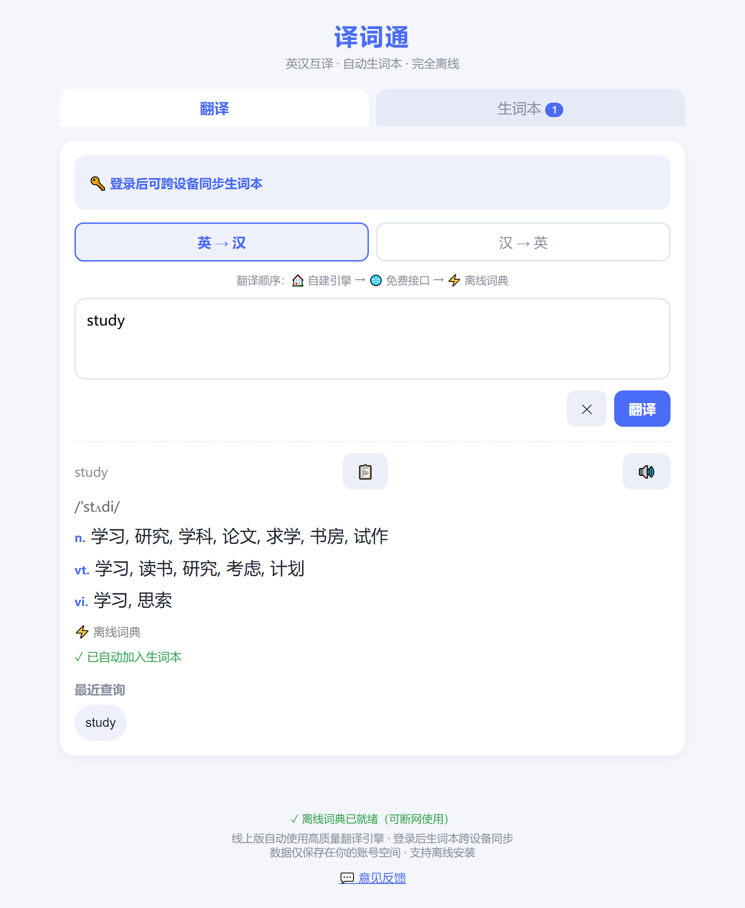
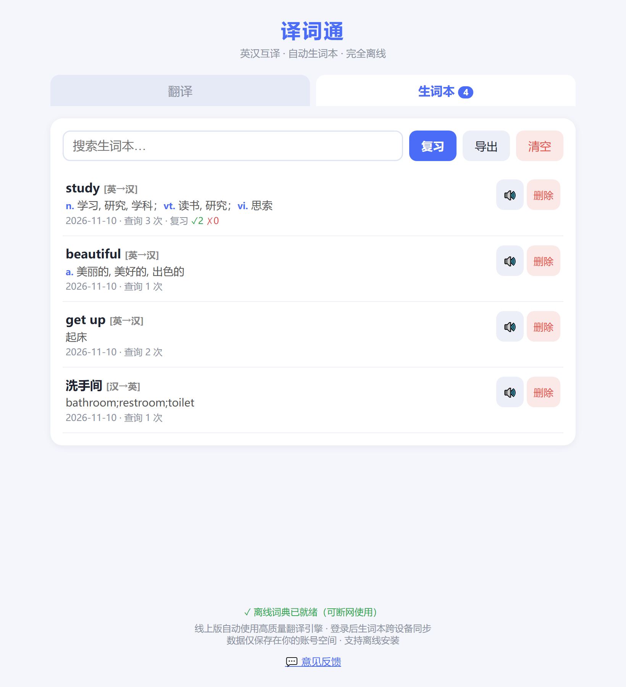
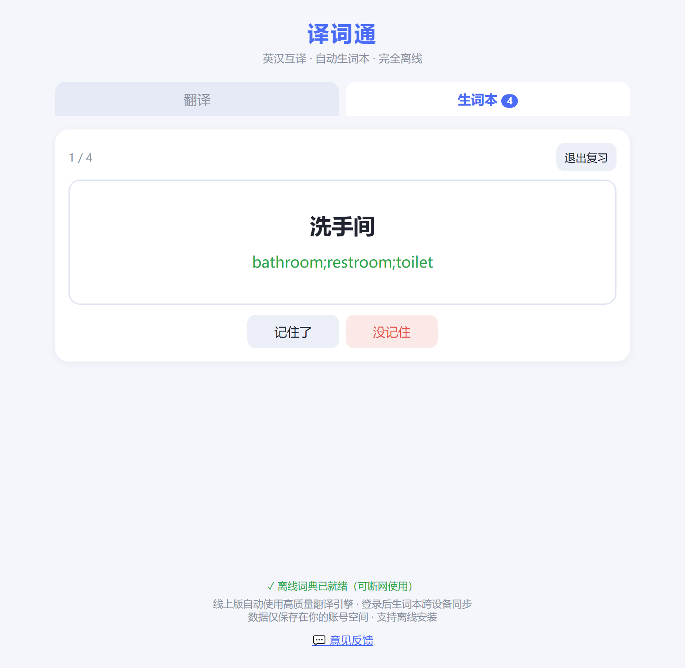

# 译词通 TransWord

**英汉互译 + 自动生词本 · 完全离线可用 · 手机 / 电脑 / 网页通用**

查过的每一个单词和句子都会自动进入生词本，不需要手动收藏。

### 👉 [立即使用](https://107-175-122-81.sslip.io/transword/)

无需注册即可使用全部功能。登录只是为了多设备同步生词本。

---

## 界面预览

| 查词：音标 + 按词性分行 | 生词本：自动收录 | 复习：记忆卡片 |
|---|---|---|
|  |  |  |

---

## 为什么做这个

背单词卡住大多数人的不是"记不住"，而是**收集太麻烦**。

查词和记词在产品上通常是割裂的两件事：查词工具只管给释义，生词本只管陈列你手动塞进去的东西。中间那一步"手动塞"，在实际使用中几乎必然失败。

这个工具只坚持一个原则：**查即收藏**。

---

## 功能

### 查词
- **音标 + 按词性分行的完整释义**，不是只给第一个义项

  ```
  study
  /ˈstʌdi/
  n.  学习, 研究, 学科, 论文, 求学, 书房, 试作
  vt. 学习, 读书, 研究, 考虑, 计划
  vi. 学习, 思索
  ```

- 一词多义按常用程度排序
- 收录短语动词（`get up` → 起床、`turn off` → 关闭、`look for` → 寻找）
- 收录动词变形（`made` / `studies` / `running` 等 800+ 形态）

### 生词本
- 查过的单词**和句子**自动收录，零额外操作
- 记录查询次数与时间，可搜索、导出、删除
- 删除会跨设备同步（时间戳优先合并，不会"删了又回来"）
- 点任意词条可回翻译页重查

### 复习模式
- 从生词本抽 20 个词做记忆卡片
- 先看原文回忆译文，再自评「记住了 / 没记住」
- **没记住的词下次优先出现**
- 成绩累积在词条上并跨设备同步

### 翻译
- 英译汉 / 汉译英双向切换
- 输入自动识别方向（在汉→英模式输入英文会自动按英→汉处理）
- 长文本自动分段并行翻译（366 字符约 2 秒）
- 打字停顿自动翻译，也支持回车

### 其他
- **完全离线可用**：词典缓存在本地，断网照样查词
- **PWA**：添加到主屏幕后体验接近原生 App
- 输入联想（英文前缀提示候选词，支持 ↑↓ / Enter / Esc）
- 单词朗读、译文一键复制
- 深色模式自动适配

---

## 词典规模

| 词典 | 词条数 | 说明 |
|---|---|---|
| 英汉 | 25,000+ | 含音标、按词性分类的完整释义 |
| 汉英 | 60,000+ | 中文词 → 英文表达 |

数据来源 [ECDICT](https://github.com/skywind3000/ECDICT)，并补充了短语动词、动词变形、英式/美式拼写变体、常用中文词。

---

## 技术实现

- **纯静态 PWA**，无后端渲染，首屏约 40KB
- **词典分片**：按首字母（英文 26 片）/ 哈希（中文 32 片）拆分，按需加载；完整词典由 Service Worker 后台缓存并预热进内存，预热后查词约 100ms
- **翻译链**：自建 [Argos Translate](https://github.com/argosopentech/argos-translate) 神经模型 → 免费接口兜底 → 本地词典
- **生词本存储**：默认 localStorage；登录后同步到自建服务
- **账号安全**：密码 PBKDF2-HMAC-SHA256 加盐哈希，会话令牌 90 天有效（服务器只存 SHA-256）
- **中文输入法适配**：组字期间不触发联想与翻译（`compositionstart` + `isComposing`）

---

## 自建部署

前端是纯静态文件，直接把仓库根目录丢到任意静态服务器即可（Nginx / GitHub Pages / 对象存储）。

翻译引擎与生词本同步是可选的两个独立服务，见 `deploy/` 目录：

```
deploy/transword-sync.py     # 账号 + 生词本同步 + 意见反馈（SQLite，无外部依赖）
```

前端默认指向线上服务地址，改 `app.js` 里的 `defaultApiUrl()` 和 `syncBaseUrl()` 即可指向你自己的实例。

---

## 已知不足

- 整句翻译质量不如大厂产品（Argos 模型体量有限，长句分段拼接会损失部分连贯性）
- 词典仍有覆盖不到的生僻词

**欢迎反馈具体问题**：哪个词查不到、哪句话翻得离谱、哪个操作让你多点了两下。

应用底部有「💬 意见反馈」，或在 Issues 里提。

---

## 测试

```bash
node test.js        # 前端逻辑与交互（190+ 断言）
python test-sync.py # 同步/账号/反馈服务（36 断言）
```

---

## License

个人项目，代码可参考。词典数据版权归 ECDICT 项目所有。
